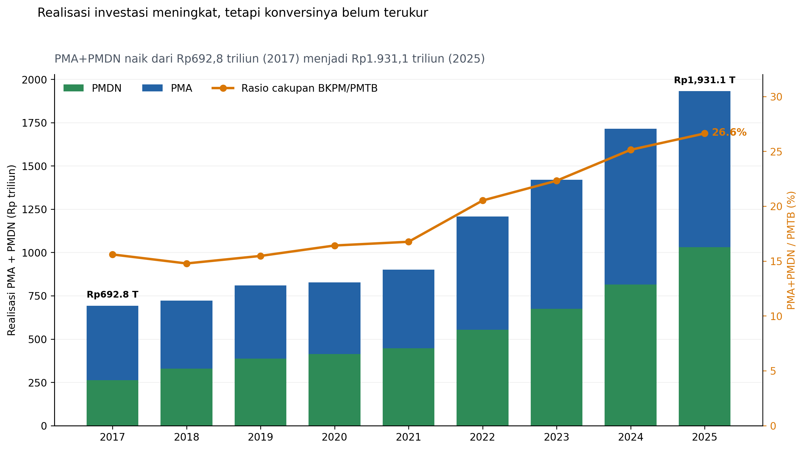
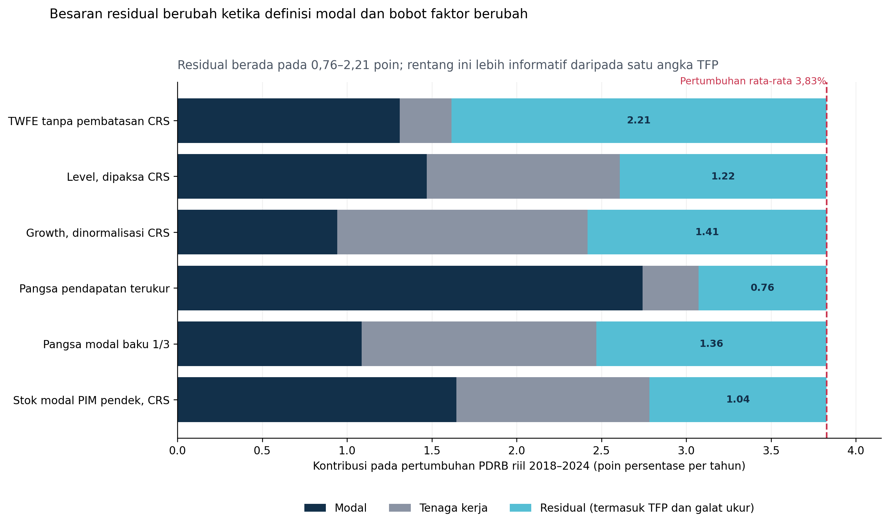
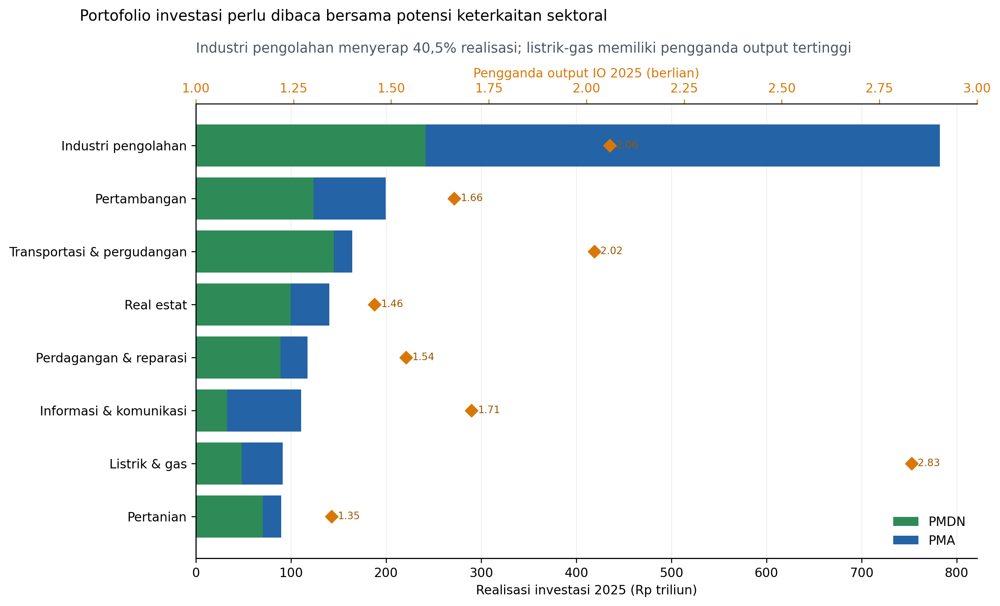
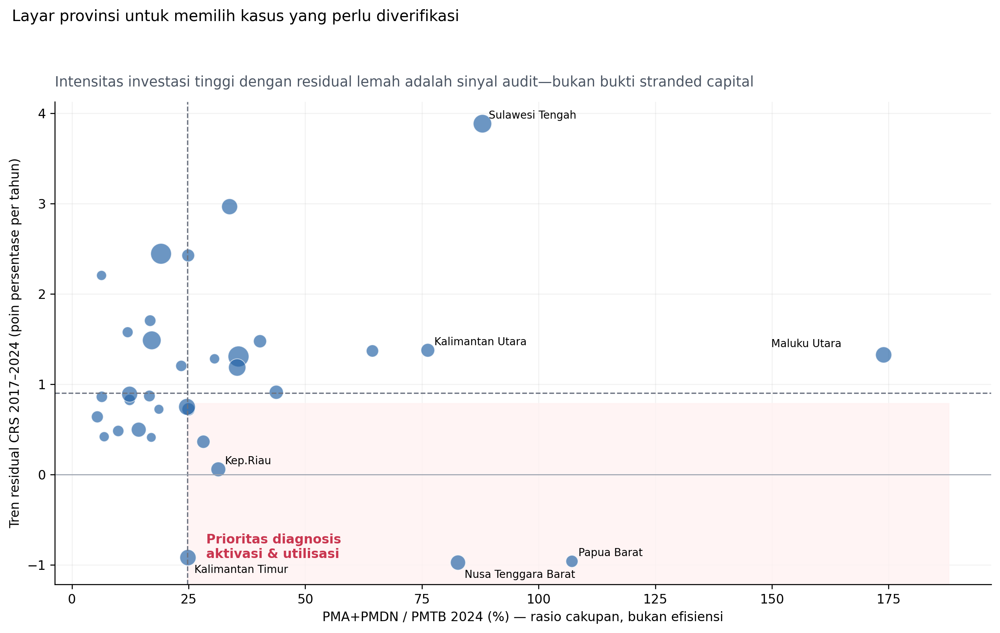

### 5.3.1 Dari Realisasi Investasi Menuju Produktivitas: Mengukur Tambahan Kapasitas, Keterampilan, Pemasok Domestik, dan Difusi Teknologi

**Pesan utama.** Realisasi investasi Indonesia meningkat kuat, tetapi perangkat pengukuran yang tersedia belum dapat memverifikasi seberapa jauh investasi tersebut telah dikonversi menjadi kapasitas yang benar-benar beroperasi dan digunakan, tenaga kerja yang naik kelas, kontrak bagi pemasok domestik, serta difusi teknologi. Ketiadaan ukuran tersebut tidak berarti bahwa konversi tidak terjadi. Temuan utamanya justru merupakan *measurement and accountability gap*: keberhasilan masih terutama terlihat pada nilai input investasi, sedangkan tambahan produktivitas setelah proyek berjalan belum menjadi indikator kinerja yang terukur secara konsisten. Karena itu, orientasi Kementerian Investasi dan Hilirisasi/BKPM perlu diperluas dari KPI volume menuju **tambahan produktivitas yang terverifikasi (*verified productivity additionality*)**.

Realisasi PMA dan PMDN nasional meningkat dari Rp692,8 triliun pada 2017 menjadi Rp1.931,1 triliun pada 2025, atau tumbuh rata-rata sekitar 13,7 persen per tahun. Pada 2025, PMDN mencapai Rp1.030,4 triliun atau 53,4 persen dari total, sementara PMA mencapai Rp900,7 triliun. Perubahan ini menunjukkan keberhasilan mobilisasi investasi sekaligus menguatnya peran modal domestik. Rasio realisasi PMA dan PMDN terhadap PMTB agregat provinsi juga naik dari 15,6 persen menjadi 26,6 persen. Namun, rasio terakhir hanya menunjukkan perubahan **cakupan relatif** antara data administratif LKPM dan PMTB dalam neraca nasional. Karena definisi, unit pelapor, serta cakupan transaksinya tidak sama, rasio tersebut tidak boleh ditafsirkan sebagai tingkat konversi, utilisasi, atau efisiensi modal.

{width=6.7in}

*Gambar 16a. Perkembangan realisasi PMA–PMDN dan rasio cakupannya terhadap PMTB, 2017–2025.*

*Sumber: Dataset Agregasi Provinsi Penyetaraan Satuan Miliar; BPS dan Kementerian Investasi dan Hilirisasi/BKPM, diolah.*

Perbedaan konsep tersebut penting bagi seluruh pembacaan produktivitas. PMA dan PMDN merekam realisasi kegiatan penanaman modal dalam cakupan administratif BKPM. Sementara itu, BPS mendefinisikan PMTB sebagai penambahan aset tetap dikurangi pengurangan aset tetap dalam suatu periode. Dengan demikian, PMTB merupakan **arus pembentukan aset**, bukan stok modal produktif atau jasa modal yang benar-benar digunakan dalam produksi. Proyek dengan masa konstruksi panjang dapat mencatat realisasi dan PMTB sebelum menghasilkan output; sebaliknya, perusahaan dapat menghasilkan output dari aset lama walaupun arus PMTB tahun berjalan kecil. Oleh sebab itu, kenaikan realisasi investasi merupakan kondisi awal yang diperlukan, tetapi belum membuktikan peningkatan kapasitas produktif, utilisasi, atau TFP dalam proporsi yang sama.

Tabel 5.3.1-1 merangkum diagnosis yang dapat dipertahankan dari keluaran terkini. Fungsi produksi panel menggunakan PDRB riil, PMTB riil, dan jumlah tenaga kerja untuk 34 provinsi pada 2017–2024. Spesifikasi *two-way fixed effects* menghasilkan koefisien PMTB sebesar 0,402 dan tenaga kerja sebesar 0,147. Koefisien tersebut lebih tepat dibaca sebagai asosiasi *within-province* setelah mengendalikan efek tetap provinsi dan tahun, bukan sebagai dampak kausal. Selain endogenitas pemilihan input, penggunaan PMTB sebagai pengganti stok modal dan pendeknya dimensi waktu membuat koefisien tidak dapat langsung ditafsirkan sebagai produktivitas marginal investasi. Jumlah koefisien sebesar 0,549 juga tidak cukup untuk menyimpulkan bahwa teknologi produksi Indonesia memiliki *decreasing returns to scale*, karena hasil tersebut dapat dipengaruhi galat pengukuran modal, komposisi sektor, gestasi proyek, utilisasi, dan variasi input lain yang tidak masuk ke dalam model.

**Tabel 5.3.1-1. Ringkasan hasil terkini dan batas interpretasinya**

| Indikator | Hasil terkini | Pembacaan yang diperbolehkan | Pembacaan yang harus dihindari |
|---|---:|---|---|
| Realisasi PMA+PMDN | Rp692,8 T (2017) menjadi Rp1.931,1 T (2025) | Mobilisasi investasi meningkat kuat | Seluruh realisasi telah menjadi kapasitas produktif |
| Pangsa PMDN 2025 | 53,4% | Modal domestik mengambil porsi lebih besar | PMDN sama dengan TKDN atau kandungan lokal |
| PMA+PMDN/PMTB | 15,6% menjadi 26,6% | Rasio cakupan untuk diagnosis | Ukuran efisiensi, utilisasi, atau *stranded capital* |
| Pertumbuhan rata-rata 2018–2024 | PDRB riil 3,83%; PMTB riil 3,26%; tenaga kerja 2,08% | Basis dekomposisi pertumbuhan | Bukti kausal dari investasi terhadap pertumbuhan |
| Koefisien TWFE | PMTB 0,402; tenaga kerja 0,147 | Asosiasi dalam provinsi, bersyarat pada spesifikasi | Produktivitas marginal atau imbal hasil proyek |
| Jumlah koefisien | 0,549; CRS ditolak | Spesifikasi sensitif terhadap skala dan pengukuran | Bukti teknologi DRS yang definitif |
| Tren residual agregat | 1,92% per tahun tanpa CRS; 1,05% dengan CRS | Rentang hasil residual berbasis PMTB | Laju kemajuan teknologi murni |
| Residual dekomposisi | 0,76–2,21 poin dari pertumbuhan 3,83% | Amplop sensitivitas yang perlu dilaporkan | Memilih satu angka sebagai “kontribusi TFP” definitif |

Dalam model tanpa pembatasan CRS, indeks efek tahun residual meningkat dari 100 pada 2017 menjadi 116,6 pada 2024 dan menghasilkan tren sekitar 1,92 persen per tahun. Ketika CRS dipaksakan, indeks 2024 menjadi 107,8 dan trennya sekitar 1,05 persen per tahun. Selisih tersebut menunjukkan bahwa istilah skala ikut terserap ke dalam residual apabila CRS tidak dipaksakan. Dengan demikian, besaran yang dihasilkan paling aman disebut **residual fungsi produksi berbasis PMTB**. Residual ini dapat memuat efisiensi, perubahan teknologi, perubahan utilisasi, kualitas tenaga kerja, realokasi sektor, *mark-up*, kejutan bersama, dan galat pengukuran sekaligus; residual tidak identik dengan teknologi.

Ketidakpastian ini tampak lebih jelas pada dekomposisi pertumbuhan. Rata-rata pertumbuhan PDRB riil agregat 34 provinsi pada 2018–2024 sebesar 3,83 persen per tahun. Bergantung pada definisi modal dan bobot faktor, kontribusi modal berada pada 0,94–2,74 poin persentase, kontribusi tenaga kerja pada 0,31–1,48 poin, dan residual pada 0,76–2,21 poin. Skenario tanpa CRS menghasilkan kontribusi modal 34,2 persen, tenaga kerja 8,0 persen, dan residual 57,8 persen. Sementara itu, penggunaan pangsa pendapatan terukur menghasilkan kontribusi modal 71,6 persen, tenaga kerja 8,6 persen, dan residual 19,7 persen. Perubahan sebesar itu berarti bahwa angka lama “64 persen pertumbuhan berasal dari modal” tidak dapat digunakan sebagai satu-satunya dasar kebijakan setelah keluaran model diperbarui. Temuan yang konsisten bukan satu persentase tertentu, melainkan bahwa **diagnosis sumber pertumbuhan sangat sensitif terhadap cara mengukur modal dan menentukan bobot faktor**.

{width=6.7in}

*Gambar 16b. Sensitivitas dekomposisi pertumbuhan PDRB riil nasional, 2018–2024.*

*Sumber: keluaran estimasi TFP terkini, diolah.*

Implikasinya, istilah *stranded capital* sebaiknya ditempatkan sebagai hipotesis operasional yang perlu diuji, bukan kesimpulan dari TFP. Modal dapat disebut tidak termanfaatkan atau terdampar apabila aset telah dibangun tetapi tidak beroperasi, beroperasi jauh di bawah kapasitas, mengalami penghentian dini, penurunan nilai, atau tidak menghasilkan arus pendapatan yang diharapkan. Data yang ada belum mengamati tanggal operasi komersial, kapasitas terpasang dan terpakai, jam mesin, konsumsi energi, penghentian aset, maupun penurunan nilai. Kombinasi investasi yang besar dengan residual produktivitas yang lemah hanya dapat digunakan untuk memilih proyek atau wilayah yang perlu diperiksa lebih lanjut. Bukti *stranding* baru terbentuk setelah status aset dan penggunaannya diverifikasi.

#### Membaca jalur transmisi secara sektoral

Analisis IO dan IRIO membantu menjawab pertanyaan yang berbeda dari TFP. TFP atau residual produksi menilai perubahan output yang tidak dijelaskan oleh input dalam suatu fungsi produksi, sedangkan pengganda IO menunjukkan seberapa besar tambahan permintaan pada suatu sektor menyebar melalui struktur input antara yang diasumsikan tetap. Karena itu, pengganda IO dapat digunakan untuk menyaring potensi keterkaitan, tetapi tidak mengukur utilisasi, perubahan teknologi, harga, substitusi, atau kausalitas. Hasil juga perlu dibaca sebagai estimasi *cross-entropy* dan dibandingkan dengan hasil RAS sebagai uji sensitivitas. Koefisien pengganda tenaga kerja dan pendapatan tenaga kerja belum tersedia dalam keluaran IO saat ini, sehingga kajian belum dapat menyatakan bahwa *workforce multiplier* meningkat atau stagnan.

Pada 2025, industri pengolahan menerima Rp782,3 triliun atau 40,5 persen dari seluruh realisasi sektoral PMA–PMDN. Di dalam sektor tersebut, pangsa PMA mencapai 69,1 persen dan pengganda output IO tercatat 2,06, dengan klasifikasi keterkaitan ke belakang yang kuat. Posisi ini menjadikan industri pengolahan kandidat utama untuk program pemasok domestik dan difusi teknologi. Sektor informasi dan komunikasi juga dominan PMA (70,4 persen) dan memiliki keterkaitan ke depan yang kuat, sehingga dukungan investasi perlu dihubungkan dengan adopsi teknologi oleh perusahaan domestik, keterlibatan insinyur Indonesia, dan penggunaan solusi digital dalam rantai produksi. Listrik dan gas memiliki pengganda output tertinggi di antara sektor utama (2,83) serta keterkaitan kuat ke belakang dan ke depan; fungsinya dapat diperlakukan sebagai infrastruktur pelengkap untuk mengaktifkan kapasitas pada sektor lain. Transportasi dan pergudangan juga berada pada kuadran keterkaitan kunci dengan pengganda 2,02.

{width=6.7in}

*Gambar 16c. Komposisi PMA–PMDN dan potensi transmisi IO pada delapan sektor utama, 2025.*

*Sumber: Dataset Agregasi Provinsi Penyetaraan Satuan Miliar dan IO nasional 2025 hasil pembaruan dengan cross-entropy, diolah.*

**Tabel 5.3.1-2. Layar portofolio sektor untuk intervensi produktivitas**

| Sektor | Realisasi 2025 (Rp T) | Pangsa investasi | Pangsa PMA dalam sektor | Pengganda output IO | Arah intervensi awal |
|---|---:|---:|---:|---:|---|
| Industri pengolahan | 782,3 | 40,5% | 69,1% | 2,06 | Pemasok lokal, standardisasi, insinyur lokal, dan transfer proses |
| Pertambangan | 199,6 | 10,3% | 38,0% | 1,66 | Verifikasi hilirisasi, utilisasi, nilai tambah lokal, dan keterkaitan ke depan |
| Transportasi dan pergudangan | 164,5 | 8,5% | 11,9% | 2,02 | Hilangkan hambatan logistik yang menahan operasi aset lain |
| Real estat | 140,4 | 7,3% | 29,0% | 1,46 | Uji okupansi, penggunaan aset, dan tambahan output; batasi insentif berbasis nilai tanah |
| Perdagangan dan reparasi | 117,5 | 6,1% | 24,4% | 1,54 | Efisiensi distribusi, formalitas pemasok, dan digitalisasi rantai pasok |
| Informasi dan komunikasi | 110,6 | 5,7% | 70,4% | 1,71 | Difusi teknologi, pengembangan vendor lokal, dan kapasitas rekayasa domestik |
| Listrik dan gas | 91,4 | 4,7% | 47,3% | 2,83 | Aktivasi kawasan/proyek, reliabilitas pasokan, dan keterhubungan jaringan |
| Pertanian | 89,8 | 4,6% | 21,8% | 1,35 | Produktivitas petani, stabilisasi mutu/pasokan, penyimpanan, dan akses pasar |

Tabel tersebut tidak dimaksudkan untuk membuat peringkat insentif mekanis berdasarkan pengganda tertinggi. Besarnya investasi, jenis proyek, gestasi, impor input, ketersediaan pemasok, kondisi pasar, dan kapasitas daerah tetap perlu dinilai. Khusus pertanian, perikanan, peternakan, dan perkebunan, keluaran investasi perlu dihubungkan dengan produktivitas produsen dasar: hasil per hektare atau per pekerja, susut pascapanen, mutu, volatilitas harga yang diterima produsen, kontrak pembelian, akses rantai dingin, dan jumlah produsen yang masuk ke dalam rantai formal. Dengan demikian, agenda hilirisasi tidak berhenti pada fasilitas pengolahan, tetapi juga meningkatkan kemampuan dan bagian nilai tambah yang diterima pelaku pada sisi hulu.

#### Dari nasional ke provinsi: memilih lokasi untuk audit konversi

Pada tingkat provinsi, rasio PMA+PMDN terhadap PMTB dapat disejajarkan—bukan digabungkan—dengan tren residual CRS dalam provinsi. Layar ini menghasilkan dua jenis kasus yang berguna. Papua Barat dan Nusa Tenggara Barat, misalnya, mencatat rasio cakupan investasi 2024 masing-masing sekitar 107,2 persen dan 82,7 persen, sementara tren residual CRS 2017–2024 berada di sekitar −1 persen per tahun. Kalimantan Timur dan Kepulauan Riau juga memiliki residual lemah dengan rasio cakupan yang relatif tinggi terhadap median sampel. Keempatnya merupakan kandidat diagnosis aktivasi, utilisasi, keterampilan, atau pemasok. Sebaliknya, Sulawesi Tengah memiliki rasio 88,0 persen dengan tren residual CRS 3,89 persen, sementara Maluku Utara memiliki rasio 173,9 persen dengan tren residual 1,33 persen. Kasus pembanding tersebut menunjukkan bahwa intensitas investasi tinggi tidak dengan sendirinya identik dengan modal yang terdampar.

{width=6.7in}

*Gambar 16d. Layar diagnostik konversi investasi tingkat provinsi.*

*Sumber: keluaran TFP 2017–2024, Dataset Agregasi Provinsi Penyetaraan Satuan Miliar, dan IRIO 2024, diolah.*

Pemilihan lokasi perlu dilanjutkan ke tingkat sektor dan proyek. Urutan analisis yang disarankan adalah: (1) menetapkan kesenjangan produktivitas nasional; (2) memilih provinsi dengan kombinasi intensitas investasi dan hasil residual yang perlu diverifikasi; (3) mengidentifikasi sektor dominan serta keterkaitan IO/IRIO; (4) memisahkan PMA dan PMDN sebagai struktur kepemilikan; dan (5) mengaudit proyek untuk memastikan kapan aset mulai beroperasi, seberapa besar kapasitas digunakan, siapa pekerja dan pemasok yang memperoleh manfaat, serta teknologi apa yang benar-benar diadopsi. Urutan ini mempertahankan orkestrasi nasional–provinsi–sektor–PMA/PMDN, tetapi mencegah pencampuran besaran yang tidak sebanding. PMA/PMDN tidak dibagi dengan TFP, dan PMA/PMDN tidak digunakan sebagai proksi TKDN.

#### Mengubah KPI BKPM: dari realisasi menuju *verified productivity additionality*

Tambahan produktivitas yang terverifikasi didefinisikan sebagai perubahan kapasitas operasi, produktivitas pekerja, kedalaman pemasok domestik, adopsi teknologi, dan tambahan output yang terjadi setelah proyek memperoleh fasilitasi atau insentif, diverifikasi terhadap kondisi awal dan—untuk evaluasi kebijakan—dibandingkan dengan jalur yang mungkin terjadi tanpa intervensi. Konsep ini tidak menggantikan target realisasi investasi; ia menambahkan lapisan hasil agar BKPM dapat membedakan proyek yang hanya membukukan pengeluaran dari proyek yang benar-benar memperluas kemampuan produksi.

**Tabel 5.3.1-3. Rancangan KPI tambahan produktivitas yang terverifikasi**

| Tahap transmisi | KPI minimum | Cara verifikasi | Waktu pelaporan | Keputusan BKPM |
|---|---|---|---|---|
| Realisasi | Nilai PMA/PMDN dan realisasi aset tetap | LKPM, bukti belanja, klasifikasi aset | Triwulanan | Memantau input dan konsistensi pelaporan |
| Aktivasi | Persentase proyek selesai; tanggal operasi komersial; waktu dari izin ke operasi | Dokumen *commissioning*, izin operasi, kunjungan lapangan | Bulanan untuk proyek prioritas | *Debottlenecking* proyek yang tertahan |
| Utilisasi | Kapasitas terpasang dan terpakai; jam operasi; konsumsi energi per unit output | Data produksi, meter energi, audit teknis | Triwulanan | Mengaktifkan aset menganggur atau menunda ekspansi baru |
| Keterampilan | Jam pelatihan tersertifikasi; penempatan; retensi 12 bulan; proporsi posisi teknis/manajerial Indonesia; kenaikan upah riil | Daftar pekerja teranonimisasi, lembaga sertifikasi, BPJS/administrasi pengupahan | Semesteran | Menyusun *skills compact* bersama investor dan daerah |
| Pemasok domestik | Nilai dan jumlah kontrak lokal; pemasok baru yang lolos standar; ketepatan mutu/pengiriman; peningkatan produktivitas pemasok | Faktur/kontrak, audit vendor, sertifikasi, data produksi pemasok | Semesteran | Program pengembangan vendor dan pembiayaan berbasis pesanan |
| Difusi teknologi | Mesin/perangkat lunak yang diadopsi; keterlibatan rekayasa lokal; R&D/paten/proses; jumlah pemasok yang mengadopsi standar/teknologi | Daftar aset, lisensi, catatan R&D, audit proses | Tahunan | Mengaitkan insentif dengan transfer kemampuan, bukan kepemilikan semata |
| Hasil | Tambahan output/nilai tambah, ekspor, produktivitas pekerja, efisiensi energi, dan upah riil | Data perusahaan yang direkonsiliasi dengan statistik resmi | Tahunan setelah operasi | Melanjutkan, memperbaiki, atau menghentikan dukungan |
| Additionality | Perubahan hasil relatif terhadap *baseline* dan kelompok pembanding | *Before–after*, *matched comparison*, atau *event study* bertahap | Evaluasi 12–36 bulan | Menilai dampak fasilitasi/insentif dan merealokasi portofolio |

KPI tersebut perlu diturunkan ke sektor. Utilisasi smelter atau pembangkit tidak dapat diukur dengan indikator yang sama seperti pusat data, rumah sakit, perkebunan, atau pelabuhan. Namun, empat komponen harus ada pada semua proyek yang memperoleh fasilitasi material: kondisi awal sebelum intervensi, target waktu, bukti administratif atau teknis yang dapat diaudit, dan hasil pascaoperasi. Pelaporan berbasis proyek juga memungkinkan istilah *stranded capital* diuji secara langsung melalui status “direncanakan–dibangun–*commissioned*–beroperasi–terutilisasi”, bukan disimpulkan dari residual makro.

#### *Quick wins* yang tetap membangun produktivitas jangka panjang

Perubahan produktivitas agregat membutuhkan waktu, sehingga implementasi memerlukan hasil antara yang terlihat tetapi tetap berada pada jalur kausal menuju produktivitas. *Quick wins* bukan pengganti reformasi jangka panjang; fungsinya menunjukkan bahwa proyek bergerak dari komitmen menuju operasi, pekerja benar-benar menggunakan keterampilannya, dan pemasok domestik masuk ke dalam produksi.

**Tabel 5.3.1-4. Paket *quick wins* untuk Kementerian Investasi dan Hilirisasi/BKPM**

| Produk kebijakan | Cakupan awal | Hasil terlihat | Hasil jangka menengah | Horizon |
|---|---|---|---|---|
| **Sprint Aktivasi dan Utilisasi Proyek** | Proyek terbesar yang selesai/hampir selesai pada provinsi berintensitas tinggi tetapi residual lemah | Daftar hambatan per proyek; proyek masuk operasi; kapasitas awal terpakai | Penurunan waktu gestasi dan peningkatan utilisasi | 100 hari, lalu triwulanan |
| **Kontrak Additionality untuk Insentif** | Proyek penerima tax holiday/fasilitasi strategis baru | Baseline dan target kapasitas, keterampilan, pemasok, teknologi ditandatangani | Insentif makin terarah pada hasil produktif | Desain 100 hari; berlaku pada proyek baru |
| **Program Pemasok Anchor** | Industri pengolahan dan TIK yang dominan PMA | Pemasok dipetakan, disertifikasi, dan memperoleh *purchase order* | Kenaikan produktivitas dan difusi standar/teknologi ke perusahaan lokal | Pilot 6 bulan; evaluasi 12–24 bulan |
| **Skills-to-Production Compact** | Industri pengolahan, listrik, transportasi, TIK, dan kesehatan pada lokasi proyek prioritas | Peserta tersertifikasi dan ditempatkan pada pekerjaan teknis | Retensi, mobilitas okupasi, dan upah riil meningkat | Pilot 6 bulan; retensi diukur 12 bulan |
| **Brownfield Productivity Window** | Pabrik/aset eksisting dengan kapasitas menganggur atau kebutuhan retrofit | Persetujuan retrofit cepat dan kenaikan kapasitas terpakai | Produktivitas lini, efisiensi energi, dan output meningkat | Seleksi 100 hari; hasil 6–12 bulan |
| **Dashboard Konversi Investasi** | Proyek prioritas lintas sektor dan provinsi | Status proyek, operasi, utilisasi, pelatihan, dan kontrak pemasok terlihat | Akuntabilitas portofolio dan alokasi dukungan berbasis bukti | Versi minimum 100 hari |

Program pemasok perlu diprioritaskan pada industri pengolahan dan TIK karena pangsa PMA yang tinggi menyediakan peluang masuknya pengetahuan, sedangkan keterkaitan ke belakang menentukan apakah manfaat tersebut mencapai perusahaan domestik. Literatur menunjukkan bahwa limpahan produktivitas FDI lebih mungkin muncul melalui hubungan pemasok daripada sekadar kedekatan horizontal dengan perusahaan asing (Javorcik, 2004; Blalock dan Gertler, 2008). Bukti Indonesia juga menunjukkan bahwa akses terhadap input antara impor dapat meningkatkan produktivitas melalui mutu dan ragam input (Amiti dan Konings, 2007). Implikasi kebijakannya bukan menutup akses terhadap teknologi dan input asing, melainkan menggunakan investasi tersebut untuk memperbesar kemampuan teknis, standardisasi, rekayasa, dan basis pemasok domestik.

Untuk sektor berbasis sumber daya seperti pertambangan, nikel, sawit, pertanian, perikanan, dan peternakan, keberhasilan hilirisasi perlu disertai indikator yang menangkap hubungan dengan sisi hulu. Contohnya adalah persentase pasokan yang berasal dari produsen lokal terverifikasi, produktivitas dan mutu bahan baku, stabilitas penerimaan produsen, susut pascapanen, akses fasilitas penyimpanan dan pengolahan, serta mobilitas pekerja lokal menuju okupasi teknis. Instrumen tersebut mengubah orientasi dari sekadar “tenaga kerja terserap” menjadi **kapabilitas tenaga kerja yang digunakan untuk memperluas pengganda produksi**.

Dengan demikian, implikasi utama bagi BKPM bukan mengurangi ambisi realisasi investasi, melainkan menambahkan disiplin konversi setelah realisasi tercatat. KPI volume tetap diperlukan untuk mengukur kemampuan menarik modal. Namun, keberhasilan transformasi investasi ditentukan oleh berapa banyak proyek yang masuk operasi tepat waktu, berapa besar kapasitas yang digunakan, berapa banyak pekerja yang memperoleh dan menggunakan keterampilan bernilai tambah, berapa besar kontrak yang mengalir kepada pemasok domestik, dan teknologi apa yang menyebar ke perusahaan lokal. Peralihan menuju *verified productivity additionality* menjadikan produktivitas sebagai hasil yang dapat dikelola dan diverifikasi, bukan sekadar residual yang dihitung setelah pertumbuhan terjadi.
